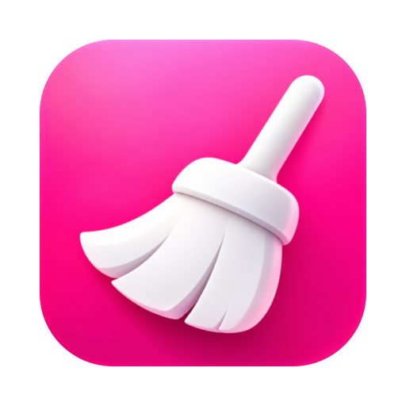

<p align="center">
  
</p>

<h1 align="center">CleanYourMac</h1>

<p align="center">
  App macOS open source para encontrar e remover o que o seu Mac guarda sem precisar.<br>
  Projeto de estudo que reimplementa, com código e arte próprios, os módulos Limpeza e Aplicativos do CleanMyMac.
</p>

> Projeto independente, sem vínculo com a MacPaw. "CleanMyMac" é marca da MacPaw Inc. Nenhum código, texto, ícone ou dado do CleanMyMac foi copiado — o comportamento foi estudado (processo *clean room*, ver [`docs/re/`](docs/re/README.md)) e reescrito do zero.

*English summary: CleanYourMac is an open-source macOS cleaner (study project). It scans system junk, AI-tool leftovers, Mail attachments and trash bins; it uninstalls or resets apps with all their files, lists outdated apps and cleans leftovers of removed apps. You review every item, and it removes only what you select.*

---

## O que ele faz

**Limpeza** — você analisa, revisa item por item no Gerenciador de Limpeza e escolhe o que apagar. Nada vem marcado sozinho.

| Categoria | O que encontra |
|---|---|
| **Detritos do sistema** | caches do usuário e do sistema, registros, binários universais (código para o processador que o Mac não usa), arquivos de idioma não usados, itens de início e preferências defeituosos, versões antigas de documentos, usuários apagados, backups antigos de iPhone/iPad, dados do Xcode |
| **Acúmulos de IA** | caches, registros, temporários e versões antigas de Claude Code, Claude, Codex, Gemini/Antigravity, Cursor, OpenCode e Chrome DevTools MCP; modelos locais do Ollama e do LM Studio |
| **Anexos do Mail** | cópias locais de anexos de contas IMAP e downloads do Mail (os arquivos que você editou ficam) |
| **Lixos** | Lixo, lixos do iCloud e de discos conectados, Lixo do Mail |

Nesta máquina de referência, a análise bate com a do CleanMyMac 5.7.2 grupo a grupo — veja o [relatório de paridade](docs/re/parity/report-2026-10-20.md).

**Aplicativos** (v0.2) — três partes, como no CleanMyMac:

| Parte | O que faz |
|---|---|
| **Desinstalador** | lista os apps com a última abertura e o tamanho total (app + arquivos espalhados pelo sistema); filtros por uso, loja, fornecedor e plug-ins de áudio; cada app abre os arquivos dele por tipo. **Desinstalar** leva o app e os arquivos marcados; **Redefinir** leva só os arquivos e mantém o app |
| **Atualizador** | mostra os apps com versão nova (App Store, canal de atualização do próprio app, Homebrew) e as atualizações do macOS. Nesta versão ele **não instala nada**: o botão abre a App Store, os Ajustes, o próprio app ou mostra o comando do Homebrew |
| **Sobras** | arquivos de apps que já foram apagados e instaladores (DMG) esquecidos |

Tudo o que o módulo Aplicativos remove vai para o **Lixo** (os DMG são apagados na hora). Apps abertos precisam ser fechados antes de desinstalar. Só é consultada a rede durante a análise, para checar versões; nenhuma lista de apps sai do Mac (o catálogo do Homebrew é baixado e comparado localmente). Veja o [relatório de paridade](docs/re/parity/apps-report-2026-10-21.md).

Os módulos Desempenho e Lupa de Espaço estão no roadmap.

## Instalar

Requisitos: macOS 14 ou mais novo, Apple Silicon ou Intel.

### Baixar a release

1. Baixe `CleanYourMac-<versão>.zip` em [Releases](https://github.com/guigx7/CleanYourMac/releases) e mova o app para **Aplicativos**.
2. Ainda não há assinatura de "Developer ID" nem notarização da Apple. Na primeira vez, o macOS vai dizer que não pode verificar o desenvolvedor. Para abrir:
   - **Ajustes do Sistema › Privacidade e Segurança** → em "CleanYourMac foi bloqueado", clique em **Abrir Mesmo Assim**; ou
   - no Terminal: `xattr -dr com.apple.quarantine /Applications/CleanYourMac.app`
3. O *ajudante* (veja abaixo) pode não ser aceito em outros Macs enquanto o app não for notarizado. Nesse caso o app pede a sua senha quando precisar — tudo continua funcionando.

### Compilar a partir do código

```bash
brew install xcodegen
git clone https://github.com/guigx7/CleanYourMac.git && cd CleanYourMac
xcodegen generate
open CleanYourMac.xcodeproj
```

No Xcode, em **Signing & Capabilities**, troque o time pelo seu (o `project.yml` usa o do mantenedor). Builds **Debug simulam a limpeza** por padrão (`CYM_DRY_RUN=0` desliga); o build **Release apaga de verdade**.

## Permissões

| Permissão | Para quê | Onde conceder |
|---|---|---|
| **Acesso Total ao Disco** | sem ele, o macOS esconde dados do Mail, do Safari e de outros apps | Ajustes › Privacidade e Segurança › Acesso Total ao Disco › **+** › CleanYourMac |
| **Ajudante (opcional)** | mede os caches do sistema em toda análise e limpa itens do sistema sem pedir senha; desinstala apps de outros donos e descarrega serviços do sistema dos apps | botão **Instalar ajudante** nos Resultados → Ajustes › Geral › Itens de Início e Extensões › permitir em segundo plano |
| **Gerenciamento de Apps** | remover código extra e idiomas de outros apps; desinstalar apps de /Applications | Ajustes › Privacidade e Segurança › Gerenciamento de Apps |

**Sobre o ajudante:** é um serviço do sistema (SMAppService) embutido no app. Ele só aceita conexões do CleanYourMac assinado pelo mesmo desenvolvedor, não executa scripts — apenas apagar, esvaziar pasta, afinar binário, medir, mover para o Lixo de quem pediu, descarregar um serviço do launchd e esquecer o recibo de um pacote — e revalida cada pedido como root (nunca locais vitais, nunca através de links, nunca itens `com.apple.*`, sempre ligado ao app escolhido). Depois de atualizar o app, use **Atualizar ajudante** se o botão aparecer. Para remover: desative-o em Itens de Início e Extensões.

## Use com cuidado

- Na **Limpeza**, a remoção é **definitiva** (não vai para o Lixo), como no CleanMyMac. Nos **Aplicativos**, apps e arquivos vão para o Lixo. Revise antes de confirmar.
- Ao alterar apps (binários universais e idiomas), a assinatura é verificada antes e depois; se quebrasse, o app é restaurado.
- Cada limpeza gera um registro em `~/Library/Logs/CleanYourMac/`.
- Software fornecido "como está", sem garantias (licença MIT).

## Para desenvolvedores

| | |
|---|---|
| Testes do Core | `swift test --package-path Core` |
| Testes do app | `scripts/test-app.sh` |
| CLI de diagnóstico (só leitura/simulação) | `swift run --package-path Core cym scan` · `cym clean --dry-run` · `cym apps [--json] [--no-network]` |
| Comparar com uma baseline | `python3 -I scripts/parity/compare.py <baseline.json> <cym.json>` · Aplicativos: `compare_apps.py` |

Estrutura: `Core/` (pacote Swift: scanners, motor de análise e de limpeza, helper), `App/` (SwiftUI), `Helper/` (daemon privilegiado), `docs/re/specs/` (especificação de cada grupo), `docs/superpowers/` (design e plano).

Para contribuir com uma regra nova: comece pela especificação em `docs/re/specs/` (comportamento descrito com evidências) e por testes em pastas temporárias — nunca pelo disco real. Veja [`docs/re/README.md`](docs/re/README.md).

## Roadmap

- [x] **v0.1 — Limpeza**
- [x] **v0.2 — Aplicativos**: desinstalador, redefinir, atualizador (mostra e abre), sobras e instaladores
- [ ] Atualizador, etapa 2: instalar sozinho apps de site próprio e do Homebrew, conferindo a assinatura
- [ ] Desempenho: tarefas de manutenção, itens de início e em segundo plano
- [ ] Lupa de Espaço: mapa visual do armazenamento e pastas grandes
- [ ] Assinatura Developer ID e notarização

## Licença

[MIT](LICENSE)
